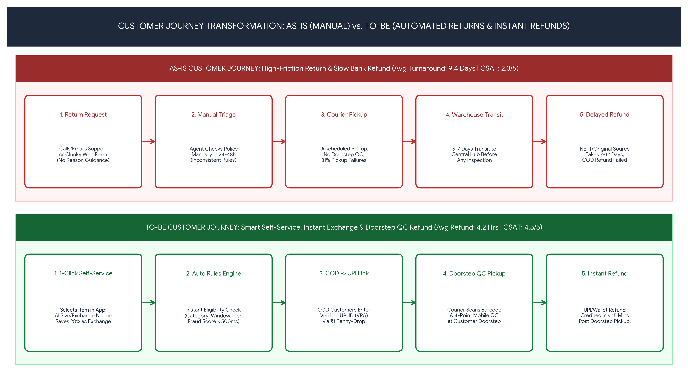

# Customer Journey Analysis: As-Is vs. To-Be

This journey map is a proposed model for a fictional e-commerce business. The As-Is journey represents common pain-point hypotheses; it is not based on interviews or an operational audit. The To-Be journey is a design proposal.

## Journey stages
1. **Initiation:** make return and exchange options visible from order history.
2. **Eligibility:** explain category rules, deadlines, and exceptions before submission.
3. **Refund details:** validate payout details and clearly state available payout methods.
4. **Pickup and quality check:** show the customer what is checked, capture exception reasons, and provide a dispute path.
5. **Refund tracking:** show status, expected next step, and escalation route.

## Potential measures
Track eligibility decision time, successful return submissions, exchange acceptance, refund turnaround, WISMR ticket rate, pickup failure rate, dispute rate, and CSAT. Define each KPI and its denominator before setting a target.

Do not present the numerical impacts in the diagram as measured results. Any target or projected outcome needs a baseline, calculation method, owner, and validation plan.
