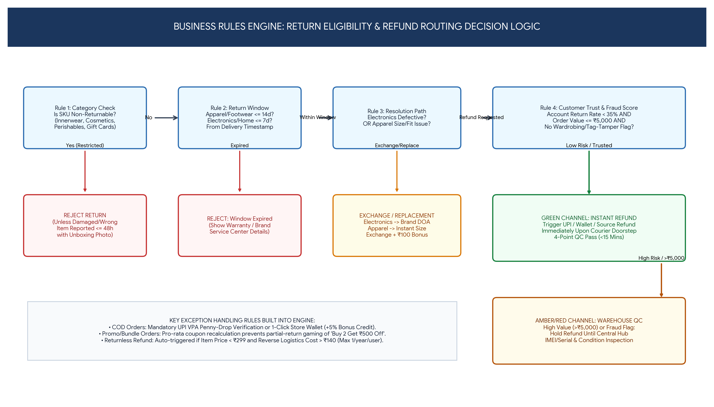

# Return Eligibility Decision Logic & Business Rules Engine

## 1. Master Decision Table (Business Rules BR-01 to BR-10)
The Return Eligibility Engine evaluates every return/exchange request deterministically across **5 sequential gates**:

| Rule ID | Evaluation Gate | Condition / Input Variables | System Action / Output | Exception / Override Rule |
| :--- | :--- | :--- | :--- | :--- |
| **BR-01** | **Category Policy Gate** | `Category IN ('Innerwear', 'Cosmetics', 'Fragrances', 'Perishables', 'Gift_Cards')` | **Block Standard Return** (`Is_Returnable = False`) | **Override (`BR-01A`):** Allow if `Reason IN ('Damaged_In_Transit', 'Wrong_Item_Sent', 'Expired_Product')` AND `Hours_Since_Delivery <= 48` AND `Photo_Count >= 2`. |
| **BR-02** | **Time Window Gate** | • Apparel, Footwear, Lifestyle: `Days <= 14` • Electronics, Appliances: `Days <= 7` • Home & Decor: `Days <= 10` | **Allow** if `Current_Date - Delivery_Date <= Window`; else **Reject (`Window_Expired`)** | **Override (`BR-02A`):** Amazon Prime members receive `+3 grace days` on Apparel/Lifestyle categories. |
| **BR-03** | **Electronics Resolution Gate** | `Category == 'Electronics'` AND `Reason == 'Defective_Item'` | **Allow Replacement / Brand DOA Only** (Block direct cash refund on 1st request) | **Override (`BR-03A`):** If replacement ASIN is `Out_Of_Stock` OR 2nd unit is also defective, unlock **100% Full Refund**. |
| **BR-04** | **Exchange-First Nudge Gate** | `Category IN ('Apparel', 'Footwear')` AND `Reason IN ('Size_Too_Small', 'Size_Too_Large', 'Style_Fit')` | Present **1-Click Free Size Exchange** + lock replacement stock for 48h + offer `₹100` bonus coupon | If desired size is `Out_Of_Stock`, skip nudge and proceed directly to Refund selection. |
| **BR-05** | **Promo & Bundle Pro-Rata Math** | Order used conditional coupon (e.g., `Buy ₹2,000 Get ₹400 Off`) AND remaining kept items drop cart below threshold | **Recalculate Net Refund:** `Refund = Item_Paid_Price - Revoked_Discount_Benefit` | **Override (`BR-05A`):** Do **NOT** revoke coupon if return reason is Amazon FBA / Seller fulfilment fault (`Damaged` or `Wrong_Item_Sent`) — refund full prorated amount. |
| **BR-06** | **Risk & Fraud Routing Gate** | • `User_Return_Rate < 35%` • `Item_Value <= ₹5,000` • `Account_Age >= 30 days` • `No_Prior_QC_Dispute == True` | **GREEN CHANNEL:** Eligible for **Instant Refund upon Doorstep QC Pass** (`<15 mins`) | **RED CHANNEL:** If any condition fails (`Item_Value > ₹5,000` OR `Risk_Score >= 60`), route to **Warehouse Hub Inspection Hold** (Refund after FC C-Returns AFT scan). |
| **BR-07** | **Pay on Delivery (PoD / COD) Refund Payout Gate** | `Original_Payment_Mode == 'Pay on Delivery (PoD / COD)'` | Require **Verified UPI VPA** (via `₹1` Penny-Drop name match `>= 75%`) OR **Amazon Pay Balance** | If Penny-Drop fails 3 times, fall back to Bank IMPS with cancelled cheque upload. |
| **BR-08** | **Doorstep 4-Point QC Gate** | ATS Delivery Associate Rabbit App checks: `1. Barcode Match`, `2. Brand Tag Intact`, `3. Unused/Unwashed`, `4. Accessories/IMEI Match` | All 4 Pass -> **Accept Parcel & Trigger Green Refund** Any Fail -> **Reject Pickup on Spot** | Customer can contest a doorstep rejection within 24h by uploading unboxing/item photos to Escalation Desk. |
| **BR-09** | **Returnless Refund Gate** | `Selling_Price < ₹299` AND `Est_Reverse_Shipping_Cost > ₹140` AND `Reason == 'Damaged'` AND `User_Risk == 'Low'` | **Issue Instant Refund without Pickup** ("Keep or Donate the Item") | Hard limit of **1 Returnless Refund per customer per 365 days** to prevent systematic abuse. |
| **BR-10** | **Restocking & Shipping Fee** | Standard return on low-risk account | **₹0 Return Shipping Fee** | Accounts in the **Top 2% Serial Returner cohort (`Return_Rate > 55%`)** are charged a `₹99` convenience pickup fee (waived for defective items). |

---

## 2. Worked Example: Pro-Rata Coupon & Bundle Exception Calculation (`BR-05`)
* **Order Scenario:** Customer buys **Shirt A (`₹1,200`)** + **Trousers B (`₹1,300`)** = **Gross Cart `₹2,500`**.
* **Applied Coupon:** `SAVE500` (*Flat ₹500 off on minimum purchase of ₹2,000*). Net Paid = **`₹2,000`** (Shirt A effective paid = `₹960`; Trousers B effective paid = `₹1,040`).
* **Case 1 (Customer Returns Shirt A due to "Changed Mind"):**
  * Remaining kept item (Trousers B = `₹1,300`) no longer qualifies for the `₹2,000` minimum threshold of `SAVE500`.
  * **Rule `BR-05` Calculation:** `Net Refund = Total Paid (₹2,000) - Full Price of Kept Item (₹1,300) = ₹700` (Customer is shown clear breakdown: *Item Price ₹1,200 - ₹500 Promo Adjustment = ₹700 Refund, OR Exchange Shirt A for ₹0 deduction!*).
* **Case 2 (Customer Returns Shirt A due to "Damaged / Defective Item" verified at QC):**
  * **Rule `BR-05A` Exception:** Customer is **not penalized** for seller/platform fault. Customer receives full prorated paid amount = **`₹960`**, and retains the prorated `₹260` discount on Trousers B.
